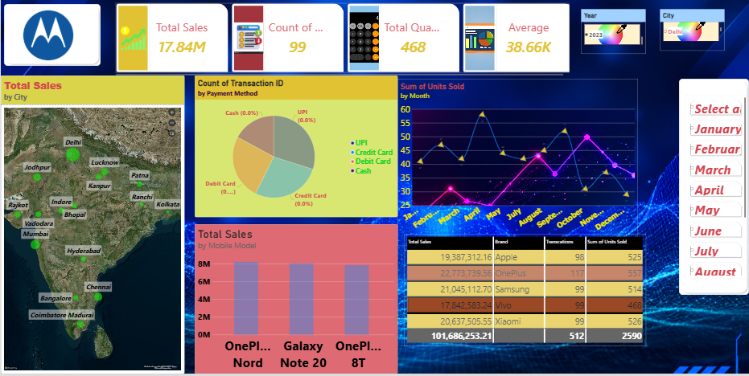

# 📊 Mobile Sales Analysis Dashboard | Power BI

An interactive Power BI dashboard designed to analyze mobile phone sales, transaction patterns, payment methods, city-wise performance, and monthly sales trends.

## 📸 Dashboard Preview

## 🎯 Project Overview

This project uses Microsoft Power BI to explore mobile sales data and present key business metrics through interactive charts, maps, tables, and slicers.

The dashboard helps users understand sales performance across cities, compare mobile models, analyze payment methods, and explore monthly trends.

## 📌 Key Performance Indicators (KPIs)

- **Total Sales:** 17.84M
- **Total Quantity Sold:** 468
- **Average Sales:** 38.66K
- **Transactions:** 99 (as displayed in the dashboard's transaction count card)

*Note: KPI values reflect the current screenshot and may change when filters are applied.*

## 📈 Dashboard Features

### 1. City-Wise Sales Analysis
- Geographic visualization of sales across Indian cities.
- Helps compare sales distribution across locations.

### 2. Payment Method Analysis
- Visualizes transaction distribution by UPI, Credit Card, Debit Card, and Cash.
- Helps explore customer payment preferences.

### 3. Monthly Trend Analysis
- Displays monthly units sold and sales patterns.
- Supports month-wise performance comparison.

### 4. Mobile Model Comparison
- Compares sales across mobile models, including OnePlus Nord, Samsung Galaxy Note 20, and OnePlus 8T.
- Helps explore product-level performance.

### 5. Interactive Filters
- Year selection
- City selection
- Month selection

These filters allow users to explore different segments of the sales data.

## 🛠️ Tools & Technologies

- Microsoft Power BI
- Data Visualization
- Business Intelligence
- Interactive Dashboards
- Data Analysis

## 💼 Business Value

This dashboard demonstrates how interactive reporting can help businesses:

- Monitor sales performance.
- Compare city-wise results.
- Understand payment method distribution.
- Track monthly sales trends.
- Compare mobile model performance.

## 📂 Project Files

| File | Description |
|---|---|
| `Power BI Project.pbix` | Interactive Power BI report |
| `Dashboard.png` | Dashboard preview |
| `README.md` | Project documentation |

## 🚀 How to Use

1. Download or clone this repository.
2. Install Microsoft Power BI Desktop.
3. Open `Power BI Project.pbix`.
4. Configure the data source if Power BI prompts you.
5. Use the dashboard slicers to explore the report.

## 👨‍💻 Skills Demonstrated

- Data Analysis
- Data Visualization
- Business Intelligence
- Dashboard Design
- Interactive Reporting
- Microsoft Power BI

## 👤 About Me

I am a B.Tech Information Technology student interested in Data Analytics and Business Intelligence. I am building practical projects to strengthen my skills and develop a professional Data Analyst portfolio.

## ⭐ Feedback

Suggestions and feedback are welcome!

If you find this project useful, consider giving this repository a star.

#PowerBI #DataAnalytics #BusinessIntelligence #DataVisualization
